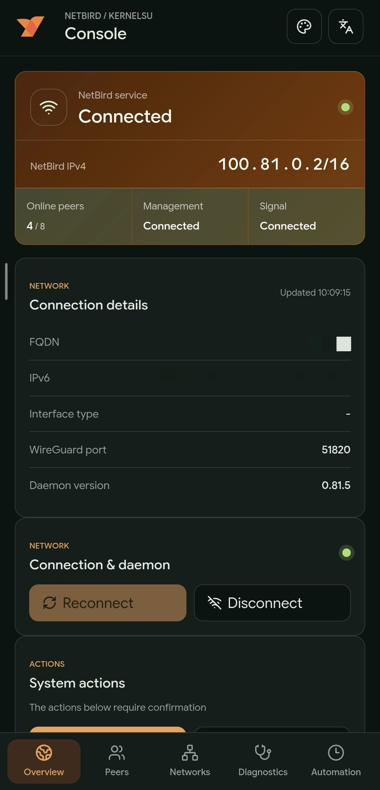

<p align="center">
  
</p>

<h1 align="center">Magisk NetBird</h1>

<p align="center">
  
  
  
  
  
</p>

<p align="center"><b><a href="README.md">English</a> · <a href="README.zh-CN.md">中文</a></b></p>

Minimal Magisk module wrapper for the NetBird CLI daemon. Official NetBird
binaries (currently v0.81.4) are bundled for three architectures.

DNS management is disabled by default when joining with `netbird.service up`.

## Download

| Zip | Devices |
| --- | --- |
| `magisk-netbird-<version>.zip` | arm64-v8a, armeabi-v7a, and x86_64 |

Latest release: <https://github.com/ahsaboy/magisk-netbird/releases/latest>

The release ZIP contains all three NetBird binaries and installs on arm64-v8a,
32-bit ARM, and x86_64. Magisk-compatible managers can check for updates from
the module's update information. The ACTION button needs Magisk v28+.

## Usage

Connect and check status:

```sh
su -c 'netbird.service up --setup-key <KEY> --management-url <URL>'
su -c 'netbird.service status'
su -c 'netbird.service down'   # disconnect; daemon stays running
su -c 'netbird.service stop'   # stop the daemon
su -c 'netbird.service start'
su -c 'netbird.service peers'
su -c 'netbird.service log --once'
```

On KernelSU without a mount metamodule installed, the module's `system/bin`
overlay is not mounted and `netbird.service` may be missing from `PATH` after
a reboot. The module re-creates `/dev/netbird` and `/dev/netbird.service`
symlinks on every boot; use those as a drop-in replacement:

```sh
su -c '/dev/netbird.service status'
```

To keep the setup key out of shell history and `ps` output, prefer a file:

```sh
su -c 'echo -n <KEY> > /data/adb/netbird/setup.key && chmod 600 /data/adb/netbird/setup.key'
su -c 'netbird.service up --setup-key-file /data/adb/netbird/setup.key --management-url <URL>'
```

Inspect peers with `netbird.service peers` for connection type, latency, traffic,
and last-handshake details.

The module ACTION button is a shortcut for manager users. KernelSU users can open
the WebUI for status, routes, health, profiles, and scheduled automation controls.
`down` disconnects without stopping the daemon or watcher; use `stop` to stop
the daemon.

<p align="center">
  
</p>

## Configuration

Defaults are set in `netbird/settings.sh`; override any of them via environment
variables (environment outranks CLI flags in NetBird):

| Variable | Default | Effect |
| --- | --- | --- |
| `NB_DISABLE_DNS` | `true` | Also enforced on `up` via `--disable-dns`. |
| `NB_DISABLE_IPV6` | `false` | When `true`, `up` appends `--disable-ipv6`; this disables NetBird overlay IPv6 and is not a firewall compatibility workaround. |
| `NB_DISABLE_FIREWALL` | `false` | When `true`, `up` appends `--disable-firewall` (client stops managing firewall rules). |
| `NB_FORCE_USERSPACE_FIREWALL` | `auto` | Automatically forced when Android has no usable `ip6tables` nat table; set explicitly to override detection. |
| `NB_WG_KERNEL_DISABLED` | `auto` | Automatically forced with the userspace-firewall fallback unless explicitly set. |
| `NB_DISABLE_SSH_CONFIG` | `true` | Skips writing `/etc/ssh/ssh_config.d` (read-only on Android). |
| `NB_SKIP_NFTABLES_CHECK` | `true` | Skips the nftables probe, which always fails on Android. |
| `NB_SKIP_DNS_PROBE` | `true` | Skips the local-resolver startup probe. |
| `NB_NETWORK_MONITOR` | `true` | Upstream defaults to `false` on Linux; enabled for faster reconnects after network switches. |
| `NB_STATE_DIR` | `/data/adb/netbird` | Writable location for `state.json` / WireGuard keys (upstream default `/var/lib/netbird` does not exist on Android). |
| `NB_LOG_LEVEL` | `info` | NetBird log level. |
| `NB_LOG_MAX_SIZE_MB` | `5` | NetBird's own log-rotation cap for `client.log` in MiB (upstream default 15). |
| `NB_WATCHDOG` | `on` | Watchdog: auto-restart the daemon when its status stops responding; `off` disables. |
| `NB_WATCHDOG_FAILS` | `3` | Consecutive failed status probes before a restart (30s apart while connected, 300s while disconnected). |
| `NB_WATCHDOG_MAX_RESTARTS` | `10` | Restart budget; reset after 5 healthy probes. |

All of the variables above (and any other variable the official client
supports) can be persisted in `/data/adb/netbird/.env` as `KEY=VALUE` lines
(`#` starts a comment); a real environment variable still wins over the file.
Start from the installed template:

```sh
cp /data/adb/netbird/netbird.env.example /data/adb/netbird/.env
```

Daemon-read variables (e.g. `NB_LOG_LEVEL`) apply after the next
`netbird.service restart`; no reboot is needed. On Android builds without a usable IPv6
`nat` table, the module automatically enables NetBird's userspace firewall and userspace
WireGuard so native `ip6tables` initialization cannot block startup.

Flags added by `up` persist in `config.json` and are applied on (re)connect,
so after changing them run `netbird.service down` followed by
`netbird.service up` (or `netbird.service restart`).

The watcher checks daemon process state every 30 seconds. It probes NetBird status
every 30 seconds while connected and every 300 seconds after an intentional disconnect;
the watchdog restarts an unresponsive daemon after the configured number of failed probes.
`netbird.service down` only disconnects. `netbird.service stop` stops the daemon, while
`start` or `up` starts it again. Uninstall removes the module's network rules.

## Dynamic status

While the daemon is running, `module.prop` is refreshed periodically. Because module descriptions are single-line metadata, status is shown as compact paired fields such as IP/peers, management/signal, relay/interface, memory, CA count, and refresh time. The peers field carries a direct/relay bracket (`[P3 R1]` = 3 direct, 1 relayed); `WD=n` shows accumulated watchdog restarts.

## Custom CA trust

For self-hosted NetBird servers with a private CA, place PEM certificates in `/data/adb/netbird/certs/` as `.crt`, `.pem`, or `.cer` files. `/data/adb/netbird/ca.crt` is also loaded automatically. Restart NetBird after changing certificates:

```sh
su -c 'netbird.service restart'
su -c '/data/adb/netbird/scripts/cert-trust.sh status'
```

The module injects `/system/etc/resolv.conf` for the Linux binary runtime. Android's normal app DNS is not changed by this; `netbird.service up` still disables NetBird DNS management with `--disable-dns`.

Direct NetBird commands should include the module daemon address:

```sh
su -c 'netbird --daemon-addr unix:///data/adb/netbird/run/netbird.sock status'
```
