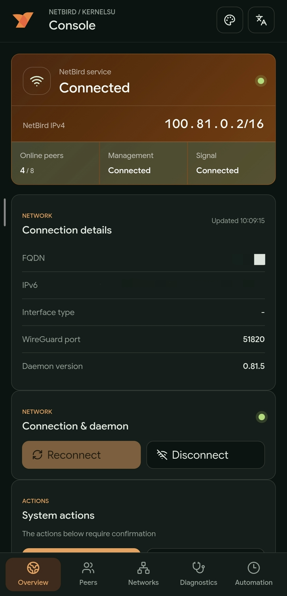

<p align="center">
  
</p>

<h1 align="center">Magisk NetBird</h1>

<p align="center">
  
  
  
  
  
</p>

<p align="center"><b><a href="README.md">English</a> · <a href="README.zh-CN.md">中文</a></b></p>

NetBird CLI 常驻进程的精简 Magisk 模块封装。为三种架构打包官方 NetBird
二进制（当前 v0.82.1）。

DNS 接管默认关闭，可通过 WebUI 的“使用 NetBird DNS”开关或 `netbird.service dns on` 启用。

## 下载

| 压缩包 | 适用设备 |
| --- | --- |
| `magisk-netbird-<version>.zip` | arm64-v8a、armeabi-v7a 和 x86_64 |

最新发布：<https://github.com/ahsaboy/magisk-netbird/releases/latest>

发布 ZIP 内含三种架构的 NetBird 二进制，可安装于 arm64-v8a、32 位 ARM
和 x86_64。支持 Magisk 更新检查的管理器可以从模块更新信息中获取新版本。
ACTION 按钮需要 Magisk v28+。

## 使用

连接并查看状态：

```sh
su -c 'netbird.service up --setup-key <KEY> --management-url <URL>'
su -c 'netbird.service status'
su -c 'netbird.service down'   # 只断开连接，daemon 继续运行
su -c 'netbird.service stop'   # 停止 daemon
su -c 'netbird.service start'
su -c 'netbird.service peers'
su -c 'netbird.service log --once'
```

在未安装挂载 metamodule（如 meta-overlayfs）的 KernelSU 上，模块的
`system/bin` 目录不会被挂载，重启后 `netbird.service` 可能不在 `PATH`
中。模块会在每次开机时重建 `/dev/netbird` 和 `/dev/netbird.service`
符号链接，可直接作为替代入口：

```sh
su -c '/dev/netbird.service status'
```

为避免 setup key 进入 shell 历史和 `ps` 输出，建议改用文件方式：

```sh
su -c 'echo -n <KEY> > /data/adb/netbird/setup.key && chmod 600 /data/adb/netbird/setup.key'
su -c 'netbird.service up --setup-key-file /data/adb/netbird/setup.key --management-url <URL>'
```

KernelSU 用户可打开模块 WebUI 查看状态、路由、健康信息和配置，并管理连接及定时自动化规则。
`down` 只断开连接，不会停止 daemon 或 watcher；需要停止 daemon 时使用 `stop`。

<p align="center">
  
</p>

## 配置

默认值在 `netbird/settings.sh` 中设置；可通过环境变量覆盖（NetBird 中
环境变量的优先级高于命令行参数）：

| 变量 | 默认值 | 作用 |
| --- | --- | --- |
| `NB_DISABLE_DNS` | `true` | `up` 时同时通过 `--disable-dns` 强制禁用 DNS 管理。 |
| `NB_DISABLE_IPV6` | `false` | 为 `true` 时 `up` 追加 `--disable-ipv6`；该选项会关闭 NetBird overlay IPv6，不用于规避防火墙兼容性问题。 |
| `NB_DISABLE_FIREWALL` | `false` | 为 `true` 时 `up` 追加 `--disable-firewall`（客户端不再管理防火墙规则）。 |
| `NB_FORCE_USERSPACE_FIREWALL` | `自动` | Android 缺少可用的 `ip6tables` nat 表时自动启用；显式设置可覆盖自动检测。 |
| `NB_WG_KERNEL_DISABLED` | `自动` | userspace firewall 回退启用时自动强制 userspace WireGuard，除非用户显式设置。 |
| `NB_DISABLE_SSH_CONFIG` | `true` | 跳过写入 `/etc/ssh/ssh_config.d`（Android 上为只读）。 |
| `NB_SKIP_NFTABLES_CHECK` | `true` | 跳过 nftables 探测（该探测在 Android 上必然失败）。 |
| `NB_SKIP_DNS_PROBE` | `true` | 跳过本地解析器启动探测。 |
| `NB_NETWORK_MONITOR` | `true` | 上游在 Linux 上默认为 `false`；此处启用以便网络切换后更快重连。 |
| `NB_STATE_DIR` | `/data/adb/netbird` | `state.json` / WireGuard 密钥的可写存放目录（上游默认的 `/var/lib/netbird` 在 Android 上不存在）。 |
| `NB_LOG_LEVEL` | `info` | NetBird 日志级别。 |
| `NB_LOG_MAX_SIZE_MB` | `5` | NetBird 自带的 `client.log` 轮转上限（MiB，上游默认 15）。 |
| `NB_WATCHDOG` | `on` | 看门狗：daemon 状态连续无响应时自动重启；`off` 关闭。 |
| `NB_WATCHDOG_FAILS` | `3` | 连续探测失败多少次后重启（已连接时每 30 秒探测，主动断开后每 300 秒探测）。 |
| `NB_WATCHDOG_MAX_RESTARTS` | `10` | 重启预算；连续 5 次健康探测后重置。 |

上表所有变量（以及官方客户端支持的任何其他变量）都可以持久化到
`/data/adb/netbird/.env`（每行 `KEY=VALUE`，`#` 开头为注释）；真实环境
变量依然优先于该文件。从已安装的模板开始：

```sh
cp /data/adb/netbird/netbird.env.example /data/adb/netbird/.env
```
daemon 读取的变量（如 `NB_LOG_LEVEL`）在下次 `netbird.service restart`
后生效，无需重启手机。Android 缺少可用的 IPv6 `nat` 表时，模块会自动启用
NetBird userspace firewall 和 userspace WireGuard，避免 native `ip6tables` 初始化失败阻止启动。

`up` 添加的参数会持久化到 `config.json`，并在（重新）连接时生效，因此
修改后需要先执行 `netbird.service down`、再执行 `netbird.service up`
（或直接 `netbird.service restart`）。

Watcher 每 30 秒检查一次 daemon 进程；已连接时每 30 秒探测 NetBird 状态，主动断开后改为每 300 秒探测。
连续探测失败达到配置次数后，看门狗会重启无响应的 daemon。
`netbird.service down` 只断开连接；`stop` 停止 daemon，之后可用 `start` 或 `up` 启动。
卸载模块时会清理模块添加的网络规则。

## 动态状态

daemon 运行期间会定期刷新 `module.prop`。由于模块描述是单行元数据，状态
以紧凑的成对字段显示：IP/对等节点、管理/信号、中继/接口、内存、CA 数量
和刷新时间。对等节点字段带直连/中转统计（`[P3 R1]` = 3 直连、1 中转）；
`WD=n` 表示看门狗累计重启次数。

## 自定义 CA 信任

对于使用私有 CA 的自托管 NetBird 服务器，将 PEM 证书以 `.crt`、`.pem`
或 `.cer` 后缀放到 `/data/adb/netbird/certs/` 中。`/data/adb/netbird/ca.crt`
也会被自动加载。更换证书后重启 NetBird：

```sh
su -c 'netbird.service restart'
su -c '/data/adb/netbird/scripts/cert-trust.sh status'
```

模块会为 Linux 二进制运行时注入 `/system/etc/resolv.conf`。这不会改变
Android 普通应用的 DNS；`netbird.service up` 仍通过 `--disable-dns`
关闭 Linux 客户端的宿主 DNS 管理。模块自己的开关独立控制 Android DNS 接管。

## NetBird DNS

```sh
su -c 'netbird.service dns on'
su -c 'netbird.service dns status'
su -c 'netbird.service dns check'
su -c 'netbird.service dns off'
```

仅接管默认网络上的 DNS 查询。绑定到 IMS、MMS 或其他非默认网络的查询不受影响。回退支持链路本地 IPv6 解析器。

本机发出的明文 UDP/TCP 53 查询会被转给本地 helper，由它先询问 NetBird 解析器，因此 peer 名称、自定义区域和按域 nameserver 都能解析，模块不需要枚举域名。只有当名称不归 NetBird 任何处理器负责时，NetBird 才返回 `REFUSED`；这类查询会带着应用原有的 Android 路由标记，交回应用原本查询的 DNS。NetBird 解析器不可达期间也按此回退，但下文所述的已知 NetBird 名称除外。若在管理端配置了默认（catch-all）nameserver，其余名称都由 NetBird 解析。NetBird 自己返回的 `NXDOMAIN` 和 `SERVFAIL` 原样返回，因此 NetBird 可达时，其区域内的名称不会发给其他 DNS。NetBird 解析器不可达期间，peer 域名和 NetBird 按域 nameserver 的域名返回 `SERVFAIL`；其余名称（包括 NetBird 自定义区域中的记录，客户端状态里看不到这些区域）会发给原 DNS，以保证手机仍能解析。

进入其他 VPN TUN 的查询继续由该 VPN 处理。本机有解析器监听时（监听 `127.0.0.1:53` 或 `[::1]:53` 的本地 DNS 代理），发往它的查询原样到达；没有时，回环查询也会被接管，因为无法使用 Android 解析器的 root 工具会把查询发往 `127.0.0.1:53`。该 VPN 从手机直接发往其上游的明文 DNS 与普通查询一样被接管，不归 NetBird 的名称仍会到达 VPN 选定的上游。DoH、DoT、DoQ、经远端代理或非标准端口发出的 DNS，以及热点客户端的 DNS，无法透明接管，需要时请在对应工具中显式指向 NetBird 解析器。系统私人 DNS 为指定主机名，或在当前网络已验证加密 DNS 时，系统查询不经过接管，WebUI 会提示；其他 VPN 或应用内部选择的加密 DNS 无法检测。

root 进程同样被接管，但发往 NetBird 上游 nameserver 和模块引导 `resolv.conf` 服务器的查询除外，NetBird 自身依赖这些查询。使用上游路由例外的查询会进行源 NAT，将源地址改为物理网络接口的地址。若已有 root 运行的透明代理接管 root DNS，可在 `/data/adb/netbird/.env` 中设置 `NB_DNS_ROOT=bypass`。

开关在重连和重启后保留。断开或停止 NetBird 时撤销接管，重新连接时恢复；网络和 VPN 变化会在数秒内重新协调。清理只删除本模块的链、策略路由和已转换 DNS 连接；开关关闭时，各生命周期钩子不做任何事。

转发入口为 `127.0.0.1:5354` 和 `[::1]:5354`，均支持 UDP/TCP。IPv6 优先 NAT，否则使用只处理本机流量的 TPROXY（表 7121、优先级 85）。两者都不可用时，拒绝 IPv6 明文 DNS，让 Android 改用会被接管的 IPv4 DNS；若当前网络只有 IPv6 DNS，则不处理 IPv6 查询，WebUI 会说明。系统关闭 IPv6 时只接管 IPv4。模块标记只使用第 21-31 位（优先级 84 的上游例外 `0x4e400000`、TPROXY `0x4e600000`、helper 流量 `0x4ea00000`，掩码 `0xffe00000`），不改动 Android 的 netId 和策略位。专属链、优先级或路由表冲突会阻止启用。

开发验证：在 `tools/nb-dns` 下运行 `go test -race ./...`，在仓库根目录运行 `sh tests/dns.test.sh`。发布流程为三个架构编译独立 DNS 工具。

直接调用 NetBird 命令时应带上模块的 daemon 地址：

```sh
su -c 'netbird --daemon-addr unix:///data/adb/netbird/run/netbird.sock status'
```
